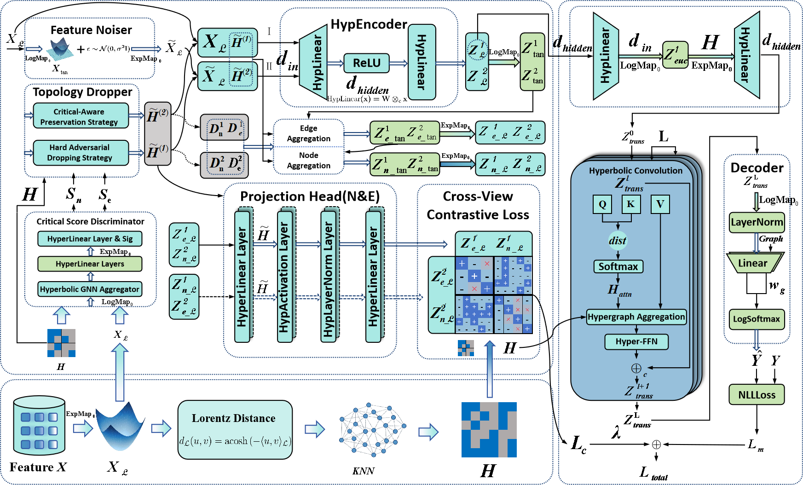

# CLhypformer

CLhypformer is a hyperbolic graph learning framework that combines contrastive hypergraph learning with a hyperbolic transformer. This repository provides the model implementations, training scripts, datasets, and manuscript results for graph node classification and single-cell RNA-seq analysis.

## The framework of CLhypformer



## Overview

- `model_source/medium/` contains the CLhypformer implementation and single-cell training code.
- `figure2/` contains the graph benchmark datasets, model code, and training entry point.
- `external_models/` contains the baseline implementations used by the workflow.
- `training/` contains the training and evaluation scripts, recorded configurations, and environment instructions.
- `paper_results/` contains the manuscript result tables and figures for direct viewing.
- `evidence/` contains the manuscript source data used to construct the reference tables.
- `run_all.sh` runs the experiment workflow.
- `download_inputs.py` downloads and verifies the single-cell training inputs.

## Dataset

The graph benchmarks include Cora, Citeseer, Disease, Twitch-PTBR, Twitch-ES, and Twitch-RU. Their input files are included in the repository.

The single-cell experiments use the GSE176078 breast cancer atlas and the GSE161529 external cohort. GSE176078 contains 100,064 cells from 26 patients and is evaluated using five patient-disjoint folds.

The prepared single-cell inputs are available in the project's [training inputs release](https://github.com/ZiyaoYang-roseate/CLhypformer/releases/tag/training-inputs).

- `GSE176078_training_inputs.tar.gz` contains the processed five-fold classification inputs and biological state features.
- `additional_inputs.tar.gz` contains the expression inputs and files required for external cohort evaluation and strict gene-held-out analysis.

The workflow downloads these two files automatically when they are missing. For manual setup, download both files and place them in the same directory as `run_all.sh`.

The public source datasets are [GSE176078](https://www.ncbi.nlm.nih.gov/geo/query/acc.cgi?acc=GSE176078) and [GSE161529](https://www.ncbi.nlm.nih.gov/geo/query/acc.cgi?acc=GSE161529).

## Dependency

Use Linux, Python 3.10, and a CUDA GPU. The main training environment uses the following libraries.

```text
torch==2.2.1+cu121
torch-geometric==2.5.3
numpy==1.26.4
pandas==2.2.2
scipy==1.11.4
scikit-learn==1.4.2
networkx==3.2.1
geoopt==0.5.0
ogb==1.3.6
```

Follow [training/environment.md](training/environment.md) to install the main environment, matching PyG extensions, and the LightHGNN and annotation environments. Set `CLHYP_LIGHT_PYTHON` and `CLHYP_ANNOTATION_PYTHON` to the Python executables of those environments, then activate the main environment before running experiments.

## Usage

Clone the repository.

```bash
git clone https://github.com/ZiyaoYang-roseate/CLhypformer.git
cd CLhypformer
```

After configuring the environments, run the full workflow.

```bash
bash run_all.sh
```

The workflow covers graph classification, graph robustness, Cora ablations and representation exports, single-cell classification comparisons, program analysis, external cohort evaluation, and single-cell ablations.

To check the environment with shorter training runs, use the smoke test.

```bash
bash run_all.sh --smoke
```

The smoke test runs a subset of the experiments. Final tables and figures are written to `runs/run.*/paper_results/` after successful completion.

## Results

The manuscript tables and figures are available in [paper_results/](paper_results/).

- `figure2*` contains graph classification, robustness, and ablation tables.
- `figure3*` contains Cora representation coordinates and topology summaries.
- `figure5*` contains single-cell classification metrics, the confusion matrix, and paired comparisons.
- `figure6*` contains program activity coordinates, gene gradients, coherence, and retrieval comparisons.
- `single_cell_*` contains the single-cell ablation results.
- `original_figures/` contains the model framework and manuscript figures.
